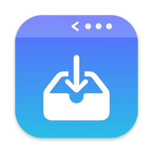
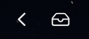
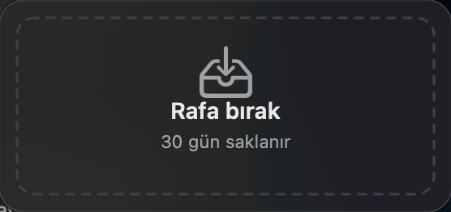

<p align="center">
  
</p>

<h1 align="center">Tuck</h1>

<p align="center">
  <b>Tidy menu bar + a drop box that remembers.</b><br>
  A tiny, native macOS menu bar app: hide the icons you don't need, and tuck away files, text, images and links for later.
</p>

<p align="center">
  <a href="https://github.com/ruhatgeles/Tuck/releases/latest"></a>
  
  
  
  <a href="LICENSE"></a>
</p>

<p align="center"><a href="#türkçe">🇹🇷 Türkçe açıklama aşağıda</a></p>

---

## Why Tuck?

- **Lives only in the menu bar.** No Dock icon, no windows, no background services.
- **Light.** Pure Swift + AppKit, zero dependencies. ~15 MB memory, 0% CPU when idle.
- **Works on macOS 27.** The classic "huge separator" trick that other menu bar hiders use breaks on the new `MenuBarAgent`; Tuck sizes the separator so it actually hides things.

## Features

### 🙈 Hide menu bar icons



- Hold **⌘** and drag any icon to the **left of the `│` separator**.
- Click **‹** to reveal them, **›** to hide again. Auto‑hides after 15 s (optional).
- Right‑click the arrow for options: auto‑hide, launch at login, quit.

### 📥 Drop box that appears when you drag



- Start dragging **anything** in any app (files, folders, text, images, links) and a drop box slides down from the menu bar.
- Drop it there, or on the tray icon. Everything stays on the shelf **until you delete it, or 30 days pass**.
- **📌 Pin** items so they never expire.
- Drag items back out to Finder, Mail, Slack… Double‑click to open, **⌘C** to copy, **⌘V** to add what's on your clipboard.
- Real thumbnails for images, PDFs and videos; size info for every item.
- **No extra disk space** for files on the same disk: APFS clones are used, not full copies.

## Install

1. Download **Tuck.zip** from the [latest release](https://github.com/ruhatgeles/Tuck/releases/latest) and unzip it.
2. Move **Tuck.app** to **Applications**.
3. Tuck isn't notarized by Apple (it's a free hobby project), so the first time: **right‑click Tuck.app → Open → Open**.
   If macOS still blocks it: *System Settings → Privacy & Security → Open Anyway*.

Universal build: runs on Apple Silicon and Intel, macOS 13 Ventura or newer.

### Build from source

Only the Xcode Command Line Tools are needed (`xcode-select --install`).

```bash
git clone https://github.com/ruhatgeles/Tuck.git
cd Tuck
./build.sh install   # builds and copies to /Applications
```

`./build.sh` builds into `build/`, and `./build.sh release` makes a universal `build/Tuck.zip`.

## Tips

| Want to… | Do this |
|---|---|
| Choose which icons hide | ⌘‑drag them left of `│` |
| Turn the drop box off | Right‑click tray icon → *Show box while dragging* |
| See where shelf files live | Right‑click tray icon → *Open shelf folder* (`~/Library/Application Support/Tuck/Shelf`) |
| Fine‑tune hiding on an unusual display | `defaults write io.github.ruhatgeles.Tuck collapsedLength 600` |

## Privacy

Tuck makes no network connections and collects nothing. Shelf items are stored locally in your Library folder and are removed when you delete them or after 30 days (unless pinned).

## Roadmap

- [ ] Clipboard history (search, pins, global shortcut, paste) 

## License

[MIT](LICENSE)

---

## Türkçe

**Tuck**, yalnızca üst çubukta yaşayan, çok az kaynak tüketen bir macOS uygulamasıdır.

- **Üst çubuk ikonlarını gizle:** ⌘ basılı tutup ikonları `│` çizgisinin soluna sürükle, sonra **‹ / ›** ile göster/gizle.
- **Bırakma kutusu:** Herhangi bir şeyi sürüklemeye başladığında üst bardan bir kutu açılır. Bıraktığın dosya, metin, görsel veya bağlantı sen silene kadar ya da 30 gün dolana kadar rafta kalır. 📌 ile sabitlenenler hiç silinmez.
- **Ekstra yer kaplamaz:** Aynı diskteki dosyalar APFS klonu olarak saklanır.

**Kurulum:** [Son sürümden](https://github.com/ruhatgeles/Tuck/releases/latest) `Tuck.zip`'i indir, `Tuck.app`'i Uygulamalar klasörüne taşı, ilk açılışta **sağ tık → Aç** de.
